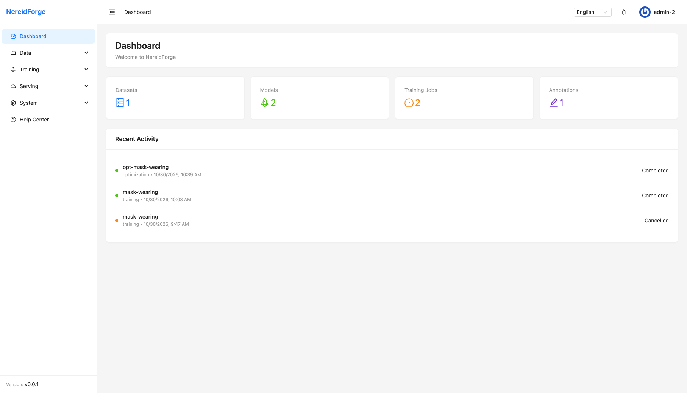

<!-- Copyright (C) 2026 YIQISOFT; SPDX-License-Identifier: Apache-2.0 -->

# NereidForge — model factory control plane

[](https://github.com/NereidAI/NereidForge/actions/workflows/ci.yml)
[](https://github.com/NereidAI/NereidForge/actions/workflows/publish-dev.yml)
[](https://github.com/NereidAI/NereidForge/actions/workflows/publish-images.yml)
[](https://github.com/NereidAI/NereidForge/actions/workflows/dco.yml)
[](https://github.com/NereidAI/NereidForge/actions/workflows/license-compliance.yml)

[](LICENSE)
[](https://github.com/NereidAI/NereidForge/actions/workflows/ci.yml)
[](python-backend/pyproject.toml)
[](frontend/package.json)
[](https://www.conventionalcommits.org/)

[](https://fastapi.tiangolo.com/)
[](frontend/package.json)
[](frontend/package.json)
[](frontend/package.json)
[](frontend/package.json)
[](https://www.kubeflow.org/)

[](https://github.com/NereidAI/NereidForge/pkgs/container/nereidforge-backend)
[](https://github.com/NereidAI/NereidForge/pkgs/container/nereidforge-frontend)



NereidForge provides dataset and annotation workflows, training, optimization,
evaluation, model registration, and inference integrations. First-party
application code lives at the repository root; deployment and integration
artifacts live under `infra/`. Vendored third-party stacks are isolated under
`infra/third_party/`.

## Directory map

| Layer | Directory | Contents |
|----|------|------|
| **Applications** | `python-backend/` | FastAPI API, synchronous SQLAlchemy worker, and notebook runtime |
| | `frontend/` | React, TypeScript, Ant Design, and Vite frontend |
| | `kfp-pipelines/` | Training, optimization, and evaluation pipeline components |
| | `optimizer-plugins/` | Manifest-driven optimization plugins |
| | `builders/` | Trainer, ML-backend, optimizer, evaluator, notebook, and shared SDK build contexts |
| **Application charts** | `charts/` | Backend, frontend, ML-backend, and tenant-check Helm charts |
| **Infrastructure** | `infra/charts/` | Supporting-service Helm charts |
| | `infra/scripts/` | Deployment, rendering, local verification, and image-build entry points |
| | `infra/configs/` | Host-neutral runtime configuration and templates |
| | `infra/third_party/` | Vendored upstream manifests and public-safe integration patches |
| **Public documentation** | `docs/product/` | Product overview and whitepaper |
| | `docs/api/openapi.yaml` | Hand-maintained HTTP API contract |
| | `builders/` | Trainer SDK, runtime, artifact, and dataset contracts |

## Development and verification

The backend requires Python 3.14 or newer. The frontend requires Node.js 24 or
newer. Prepare the shared development environment and run the standard gates:

```bash
make dev-build
make lint
make test
make license-check
```

See [CONTRIBUTING.md](CONTRIBUTING.md) for component-specific checks, DCO
requirements, source headers, and API-contract rules. Local dependencies are
defined in `docker-compose.dev.yml`; the Compose file includes no Grafana,
Loki, or Tempo server components. Set a unique `POSTGRES_PASSWORD` in an
untracked `.env` before starting Compose, and provide the same value through
`NEREIDFORGE_DATABASE_PASSWORD` to a host-run backend when it uses that
database. Object-store and JWT credentials likewise come from untracked local
configuration; no shared development secret is supplied.

## Deployment

The deployment entry point is `infra/scripts/00_deploy-all.sh`, with separate
stages for infrastructure, Kubeflow integration, and NereidForge applications.
Configuration is rendered from `infra/configs/unified/config.yaml.j2` and the
host-neutral files under `infra/configs/`. Supply site-specific domains,
object-store settings, NFS settings, identity-provider URLs, and secrets
through the documented environment inputs or untracked operator overrides.
Production overlays must not contain real credentials. Deployment requires
operator-managed PostgreSQL, object-store, JWT, and Dex credentials; in
particular, `DEX_STATIC_PASSWORD_HASH` must be the bcrypt hash matching the
verification probe's `DEX_STATIC_PASSWORD`. No shared credential fallback is
provided.

Every image reference remains at its public coordinate: suite-built images use
`ghcr.io/nereidai/<flat-name>:<tag>`, and third-party images retain their
upstream registry references. Air-gapped operators can resolve the same
references through node-level registry mirrors without rewriting tracked
configuration.

### Release packaging

Package the nine charts used by the active installation stages with:

```bash
make helm-package
```

The legacy `infra/charts/kubeflow` Helm umbrella is not an active installation
path and is not packaged. Kubeflow integration still uses the repository's
Kustomize stages and vendored manifests.

Build the repository-shaped installer archive with an explicit bare release
version when no exact Git tag is available:

```bash
RELEASE_TAG=0.1.0 make installer-package
```

The archive includes the deployment scripts, chart sources, configuration,
licenses, image manifest, and Kubeflow manifests. Its generated `release.env`
preserves the selected version after extraction without `.git`; an explicitly
exported `RELEASE_TAG` still takes precedence. The packager verifies all 23
suite-owned runtime/training image references and reparses the archive to prove
that it does not fall back to `0.0.0-dev`.

For a GitHub Release, `nereidforge-installer-<version>.tar.gz` is the **only
supported release installer**. GitHub's automatic **Source code** tar/zip
archives contain raw development chart metadata and no `release.env`; the
deployment scripts reject them rather than silently installing `0.0.0-dev`.
Use a real Git checkout for development or the custom installer for a release.

The rolling development workflow publishes only backend and frontend images.
It is not a complete Forge installation channel; use a formal release when the
ML backend and runtime/training images are required.

## License and security

NereidForge is distributed under Apache-2.0. Read
[LICENSE-POLICY.md](LICENSE-POLICY.md) and
[THIRD_PARTY_NOTICES.md](THIRD_PARTY_NOTICES.md) before adding or distributing
dependencies. A clean static scan is not, by itself, a determination that every
built image or transitive dependency is compliant; image-level findings and
review items must be resolved explicitly.

Report vulnerabilities privately using the process in
[SECURITY.md](SECURITY.md).

## Acknowledgments

NereidForge builds on the following open-source projects through runtime
integrations, pipeline tooling, container images, or self-hosted frontend
assets:

- [Kubeflow](https://github.com/kubeflow) for pipeline orchestration, training, and model-registry integration.
- [Label Studio](https://github.com/heartexlabs/label-studio) for annotation workflows and ML-backend integration.
- [CVAT](https://github.com/cvat-ai/cvat) for image and video annotation service integration.
- [Netron](https://github.com/lutzroeder/netron) for the self-hosted model graph viewer.

Third-party projects retain their own licenses. NereidForge is an independent
integration and is not endorsed by these projects or their maintainers.
